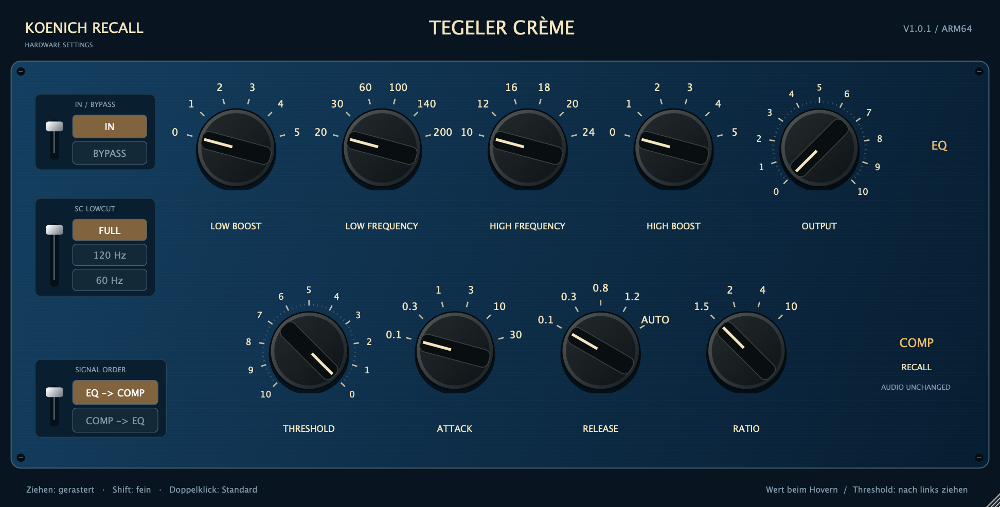

# Koenich Recall – Tegeler Crème V1.0.1

Native ARM64-VST3 für Hardware-Recall in REAPER auf macOS Apple Silicon. Die große, skalierbare Oberfläche speichert die Regler- und Schalterstellungen des Tegeler Crème im DAW-Projekt. **Das Audio wird unverändert durchgeleitet.** Das Plugin emuliert weder EQ noch Kompressor und steuert keine externe Hardware.



## Änderungen in V1.0.1

Werteselectoren entfernt, aktuelle Werte beim Hovern sichtbar. Threshold reagiert auf Linksziehen mit höherem Wert und linker Zeigerbewegung. Parameter-IDs, Rasterstufen und gespeicherte Zustände bleiben kompatibel zu V1.0.0.

## Installation

1. Das Release-ZIP entpacken und REAPER schließen.
2. Das gesamte Bundle `Koenich Recall - Tegeler Creme.vst3` nach `~/Library/Audio/Plug-Ins/VST3/` kopieren. Den Ordner bei Bedarf anlegen.
3. REAPER starten und im FX-Browser nach „Koenich Recall - Tegeler Creme“ suchen. Falls nötig unter Einstellungen → Plug-ins → VST neu scannen.
4. Einstellungen eintragen und das REAPER-Projekt speichern.

Voraussetzungen: macOS 12 oder neuer, Apple Silicon ARM64, VST3-Host. Kein Intel-Build. Das Bundle ist ad-hoc signiert, nicht Apple-notarisiert.

Dieses eigenständige Plugin verwendet eine eigene VST3-ID und ersetzt deshalb nicht automatisch Instanzen oder gespeicherte Zustände des bisherigen Tegeler-x86-Plugins. Vorhandene Hardwarepositionen müssen einmal in die neue Instanz übertragen werden.

## Bedienung

- Standardfenster: 1296 × 657 logische Pixel; bei festem Seitenverhältnis skalierbar von 1008 × 511 bis 2160 × 1095. Die Vektorgrafik bleibt auf Retina-Displays scharf.
- Die neun großen Drehregler reagieren auf vertikales Ziehen und rasten auf den vorgegebenen Stufen ein. Bei gedrückter Shift-Taste ansetzen, um feiner zu ziehen. Doppelklick setzt den jeweiligen Standardwert zurück.
- Keine Werteauswahlfelder: Beim Hovern zeigt jeder Regler seinen aktuellen Wert mit Einheit (z. B. 0.1 ms). Das Mausrad ändert keine Einstellungen versehentlich.
- Die drei Positionsschalter links sind über ihre beschrifteten Flächen oder den Hebelbereich bedienbar. Die aktive Position ist hervorgehoben.
- **IN** steht oben, **BYPASS** unten. **FULL** steht oben, **120 Hz** in der Mitte, **60 Hz** unten. **EQ → COMP** steht oben, **COMP → EQ** unten.
- Kein POWER-Schalter. Keine simulierte Pegel- oder Kompressionsanzeige: Es findet keine Signalbearbeitung statt.

## Alle 12 Recall-Parameter

| Parameter | Stufen | Standard |
|---|---|---|
| Low Boost | 0, 1, 2, 3, 4, 5 | 0 |
| Low Frequency | 20, 30, 60, 100, 140, 200 Hz | 20 Hz |
| High Frequency | 10, 12, 16, 18, 20, 24 kHz | 10 kHz |
| High Boost | 0, 1, 2, 3, 4, 5 | 0 |
| Output | 0 bis 10 in 0,2-Schritten (51 Stufen) | 0 |
| Threshold | 0 bis 10 in 0,2-Schritten (51 Stufen) | 0 |
| Attack | 0,1 / 0,3 / 1 / 3 / 10 / 30 ms | 0,1 ms |
| Release | 0,1 / 0,3 / **0,8** / 1,2 s / AUTO | 0,1 s |
| Ratio | 1,5 / 2 / 4 / 10 | 1,5 |
| IN / Bypass | IN / BYPASS | IN |
| SC Lowcut | FULL / 120 Hz / 60 Hz | FULL |
| Signal Order | EQ → COMP / COMP → EQ | EQ → COMP |

Release verwendet bewusst die vom Nutzer angegebene Stufe **0,8 s**, abweichend von der **0,6**-Beschriftung der ursprünglichen PDF-Vorlage. Output, Threshold und Boost bleiben unbenannte Hardware-Skalenwerte; zusätzliche dB-Werte werden nicht erfunden.

Threshold ist entsprechend der Frontplatte umgekehrt beschriftet: 10 links unten, 0 rechts unten. Bei Output steigt der Wert im Uhrzeigersinn. Beide zeigen 5 bei 12 Uhr. Die Sechsstufenregler überstreichen etwa 150°, Release 120°, Ratio 90°, Output und Threshold 270°. Die Winkel sind aus den Vorlagen abgeleitet, keine vermessenen mechanischen Daten. Threshold: nach links ziehen erhöht den Wert und dreht den Zeiger gegen den Uhrzeigersinn; nach rechts ziehen verringert ihn. Vertikales Aufwärtsziehen erhöht weiterhin den Zahlenwert.

Die Software-Standards sind die ersten Tabellenwerte, keine aus dem Foto übernommenen aktuellen Hardwarepositionen.

## Speicherung und Audio

Alle zwölf Parameter sind diskrete Host-Parameter und werden gemeinsam im Projekt gespeichert. GUI, Hover-Werte und Hostautomation bleiben synchron. Das State-Schema `KoenichCremeState`, Version 1, speichert Stufenindizes; die Reihenfolge der Auswahlwerte und Parameter-IDs muss bei zukünftigen Versionen erhalten bleiben. Fehlerhafte oder unvollständige Zustände werden vor der Übernahme abgelehnt. Ein zusätzlich vom Host/JUCE angebotener Plugin-Bypass gehört nicht zu den zwölf Hardwarepositionen.

Float und Double, identische Ein-/Ausgangslayouts von Mono bis 64 Kanälen, keine Latenz, kein Tail. Der Audio-Callback schreibt keine Samples und verwendet keine Allokationen oder Locks. Auch die Hardware-Recall-Stellungen IN/BYPASS und EQ/COMP verändern das Audio nicht.

## Aus dem Quellcode bauen

Voraussetzungen: Apple Silicon Mac, Xcode Command Line Tools, Git und CMake ab 3.22. Das Projekt verwendet C++17 und JUCE 8.0.15. JUCE wird beim ersten Konfigurieren von dessen offiziellem GitHub-Repository geladen.

```sh
cmake -S . -B build -DCMAKE_BUILD_TYPE=Release -DCMAKE_OSX_ARCHITECTURES=arm64
cmake --build build --parallel 4
ctest --test-dir build --output-on-failure
```

Für einen Offline-Build mit bereits vorhandenem JUCE:

```sh
cmake -S . -B build -DCMAKE_BUILD_TYPE=Release -DJUCE_SOURCE_DIR=/absoluter/Pfad/zu/JUCE
cmake --build build --parallel 4
```

Das Plugin wird erzeugt unter:

`build/KoenichRecallCreme_artefacts/Release/VST3/Koenich Recall - Tegeler Creme.vst3`

Der Test mit optionaler GUI-Vorschau und Laden der tatsächlich gebauten VST3:

```sh
build/CremeTests_artefacts/Release/CremeTests "/absoluter/Pfad/Vorschau.png" "/absoluter/Pfad/Koenich Recall - Tegeler Creme.vst3"
```

Die Tests benötigen eine angemeldete macOS-Desktop-Sitzung. Mit `-DRECALL_BUILD_TESTS=OFF` lässt sich ausschließlich das Plugin bauen. Der Build kopiert nichts automatisch in den persönlichen Plugin-Ordner.

## Repository und Release

`Source/` enthält den vollständigen Plugin-Code, `Tests/` die Verifikation, `ThirdParty/` die JUCE-Lizenzinformationen. Die Original-Referenzdateien werden nicht mitgeliefert und sind für den Build nicht erforderlich. Die Oberfläche wird vollständig im Code gezeichnet.

Tegeler und Crème sind Marken der jeweiligen Rechteinhaber. Dies ist ein unabhängiges Recall-Werkzeug, kein offizielles Tegeler-Produkt. JUCE wird separat bezogen; seine Lizenzbedingungen sind in `ThirdParty/JUCE-LICENSE.md` dokumentiert.
